# StokFácil — Backlog de Implementação (Execução Agêntica)

> **Fonte:** [`blueprint-implementacao-stokfacil.md`](./blueprint-implementacao-stokfacil.md) (prevalece sobre [`requisitos-stokfacil.md`](./requisitos-stokfacil.md) em caso de conflito — ex.: Anual R$ 299, Setup 15 itens, trial 14+16).
> **Regra de ouro:** 1 tarefa = 1 sessão de agente = 1 commit. Nenhuma tarefa começa antes das dependências estarem ✅.

## Legenda de status
⬜ A fazer · 🔄 Em andamento · 🔍 Em revisão · ✅ Aprovada · ⛔ Bloqueada (precisa de decisão)

---

## 0. Decisões assumidas (lacunas do blueprint)

Estas decisões fecham lacunas que o blueprint deixou em aberto. São **revisáveis** pelo dono do produto; se alguma mudar, as tarefas afetadas estão indicadas.

| ID | Decisão | Afeta |
| :-- | :-- | :-- |
| **D1** | **Sessão:** o cookie `auth_<slug>` deixa de guardar o PIN em texto puro e passa a guardar um token assinado com HMAC-SHA256 (`node:crypto`, segredo em `SESSION_SECRET`), contendo `{ slug, exp }`. Validade de 7 dias. | T02, T11 |
| **D2** | **Magic Link:** token HMAC no mesmo formato da sessão (`{ slug, exp, purpose: 'magic' }`, segredo `SESSION_SECRET`), validade de 7 dias, reutilizável até expirar. Consumido por um Route Handler `GET /[slug]/entrar?token=...` que grava o cookie de sessão e redireciona para `/[slug]`. Gerado pelo operador via script (sem UI de admin). | T11, T12 |
| **D3** | **"Compartilhou a vitrine"** = o lojista autenticado clicou em qualquer ação de compartilhamento (copiar link da bio, copiar legenda, compartilhar/baixar imagem). Registrado uma única vez em `namespaces.first_shared_at`. | T03, T15 |
| **D4** | **Ciclo de vida calculado sob demanda (sem cron):** uma função pura `getStoreLifecycle(namespace, now)` deriva o estado (`active` / `grace` / `paused` / `blocked`) a partir de `plan`, `trial_expires_at`, `plan_expires_at` e `status`. A coluna `status` só é usada para bloqueio manual pelo operador (`blocked`). Respeita o free tier (RNF08). | T03, T14, T16, T22 |
| **D5** | **Planos pagos:** nova coluna `plan_expires_at` (ausente no blueprint). A renovação via Pix é manual: o operador atualiza `plan` e `plan_expires_at`. | T03, T14 |
| **D6** | **Leads:** inseridos apenas pela Server Action usando service role. **Não** haverá policy pública de `INSERT` em `leads` (o blueprint propunha `WITH CHECK (true)`, o que permitiria spam direto pela anon key). | T03, T10 |
| **D7** | **Migrações** ficam em `supabase/migrations/NNN_nome.sql`, são idempotentes e **aplicadas manualmente pelo dono** no SQL Editor do Supabase. Agentes nunca executam SQL no banco remoto. | T03, T21 |
| **D8** | **Contatos do operador** via env: `NEXT_PUBLIC_ADMIN_WHATSAPP` (somente dígitos com DDI, ex.: `5511999999999`) e `NEXT_PUBLIC_SITE_URL`. | T05, T10, T14, T19 |
| **D9** | **Testes obrigatórios em toda tarefa** (regra do dono): lógica pura → Vitest; Server Actions → Vitest com Supabase/`next/headers` mockados; SQL → Vitest + PGlite (Postgres em memória); UI → Playwright E2E (desktop + iPhone/Android emulados). Tarefa sem teste não é aprovada. | Todas |
| **D10** | **Dados dos E2E:** leitura pode usar `loja-carol`; fluxos de escrita usam uma loja dedicada `e2e-teste` (PIN em `E2E_STORE_PIN`) e limpam o que criam. Nunca escrever em lojas reais. | T04b em diante |

### Problemas encontrados no código atual (corrigidos na Fase 0)
- **IDOR entre lojas:** `updateItem`, `deleteItem` e `toggleItemSold` filtram apenas por `id`, sem `namespace_id`. Qualquer lojista autenticado pode alterar itens de outra loja. → **T01**
- **PIN em texto puro no cookie.** → **T02**
- **Upload anônimo:** a policy de Storage permite `INSERT` por qualquer um com a anon key. → **T21**
- **`ItemList.tsx` monolítico (~780 linhas)**: quase toda tarefa de UI encostaria nele, gerando conflitos. → **T05**

---

## Visão geral e dependências

```mermaid
flowchart LR
    subgraph F0["Fase 0: Fundação"]
        T01["T01 Isolamento tenant"] --> T02["T02 Sessão assinada"]
        T03["T03 Migração 001 + tipos"]
        T04["T04 Vitest"]
        T01 --> T05["T05 Split ItemList"]
    end
    subgraph F1["Fase 1: Conversão e WhatsApp"]
        T06["T06 Rebranding"]
        T07["T07 WhatsApp da loja"] --> T08["T08 Pedir no Zap"]
        T09["T09 Compartilhamento"]
        T10["T10 LP + Planos"] --> T11L["T11 Form de leads"]
        T12["T12 Magic Link"] --> T13["T13 Script do operador"]
    end
    subgraph F2["Fase 2: Anti-fricção e Trial"]
        T14["T14 Lifecycle lib"] --> T15["T15 Ativação 14+16"]
        T14 --> T16["T16 Banner + Pix"]
        T17["T17 Parser de lote"] --> T18["T18 Modal de lote"]
        T19["T19 Concierge"]
        T20["T20 Compressão HEIC"] --> T21["T21 Upload assinado"]
    end
    subgraph F3["Fase 3: Escala"]
        T22["T22 Carência e pausa"]
        T23["T23 White-label"]
        T24["T24 Upload em esteira"]
        T25["T25 Kit Balcão PDF"]
    end
    F0 --> F1 --> F2 --> F3
```

> Nota: a numeração abaixo é a oficial (o diagrama abrevia alguns nomes).

---

## Fase 0 — Fundação (pré-requisito de tudo)

### T01 — Isolamento de tenant e validação nas Server Actions ✅
- **Requisitos:** RNF06 · **Depende de:** —
- **Arquivos:** `src/app/actions.ts`, `src/lib/validation.ts` (novo)
- **Escopo:**
  - Criar helper interno `requireStore(slug)` que valida auth e devolve `{ id, slug }` do namespace (ou erro).
  - `updateItem`, `deleteItem`, `toggleItemSold` passam a filtrar por `id` **e** `namespace_id`.
  - Validar entradas de `createItem`, `updateItem`, `updateNamespace` com Zod (título obrigatório 1–120 chars, preço ≥ 0 e finito, descrição ≤ 2000, `image_url` string opcional).
- **Critérios de aceite:**
  - [ ] Nenhuma query de escrita em `items` sem `.eq('namespace_id', ...)`.
  - [ ] Preço `NaN`/negativo retorna `{ success: false }` com mensagem em PT-BR.
  - [ ] Assinaturas públicas das actions inalteradas (UI continua funcionando).
  - [ ] `npm run build` e `npm run lint` passam.
- **Fora do escopo:** mudar o formato do cookie (T02).

### T02 — Sessão assinada (cookie sem PIN em texto puro) ✅
- **Requisitos:** RNF05 · **Depende de:** T01 · **Decisão:** D1
- **Arquivos:** `src/lib/session.ts` (novo, `server-only`), `src/app/actions.ts`, `.env.example`
- **Escopo:**
  - `signToken(payload)` / `verifyToken(token)` com HMAC-SHA256 + `timingSafeEqual`, payload base64url `{ slug, exp, purpose }`.
  - `authenticateNamespace` grava token de sessão (`purpose: 'session'`); `checkAuth` valida assinatura, expiração e slug.
  - Adicionar `SESSION_SECRET` ao `.env.example`. Em produção, ausência do segredo deve lançar erro claro.
- **Critérios de aceite:**
  - [ ] Cookie não contém o PIN.
  - [ ] Token adulterado, expirado ou de outro slug → não autenticado.
  - [ ] Testes Vitest para `signToken`/`verifyToken` (se T04 já concluída).
  - [ ] build + lint passam.

### T03 — Migração 001 e tipos compartilhados ✅ (aguardando aplicação no Supabase)
- **Requisitos:** RF03, RF04, RF13 · **Depende de:** — · **Decisões:** D3, D4, D5, D6, D7
- **Arquivos:** `supabase/migrations/001_stokfacil_base.sql` (novo), `src/lib/types.ts` (novo)
- **Escopo:**
  - SQL idempotente baseado na seção 2.1 do blueprint, **com os ajustes:** + `plan_expires_at TIMESTAMPTZ`, + `first_shared_at TIMESTAMPTZ`; **sem** policy pública de INSERT em `leads`; RLS habilitado em `namespaces`, `items`, `leads`, `namespace_codes` (service role continua funcionando). `CREATE POLICY` protegido contra reexecução (`DROP POLICY IF EXISTS`).
  - Tipos TS `Namespace`, `Item`, `Lead`, `Plan`, `NamespaceStatus` refletindo o schema; substituir os tipos locais de `ItemList.tsx` por imports.
- **Critérios de aceite:**
  - [ ] SQL pode rodar 2x sem erro.
  - [ ] Nenhum `any` novo; build + lint passam.
- **Ação do dono:** aplicar o SQL no Supabase antes de T07.

### T04 — Infraestrutura de testes unitários (Vitest) ✅
- **Depende de:** — · **Decisão:** D9
- **Arquivos:** `package.json`, `vitest.config.ts` (novo), `src/lib/__tests__/smoke.test.ts`
- **Critérios de aceite:**
  - [x] `npm test` roda Vitest uma vez (sem watch) e passa.
  - [x] Alias `@/` funciona nos testes.
  - [x] build + lint continuam passando (arquivos de teste não quebram o build).

### T04b — Infraestrutura de testes E2E no navegador (Playwright) ✅
- **Depende de:** T04 · **Decisão:** D10
- **Arquivos:** `package.json`, `playwright.config.ts` (novo), `e2e/*.spec.ts` (novos)
- **Escopo:** Playwright (Chromium desktop + emulação **iPhone 13** e **Pixel 7**) subindo o app via `webServer`. Testes de caracterização do comportamento **atual**: home carrega; vitrine `/loja-carol` lista produtos; modal do produto abre; login com PIN inválido mostra erro; login válido entra no modo de edição; logout. Fluxos de escrita usam a loja de testes (D10) e limpam o que criam.
- **Critérios de aceite:**
  - [ ] `npm run test:e2e` passa localmente.
  - [ ] Nenhum teste escreve na loja `loja-carol`.

### T05 — Decompor `ItemList.tsx` sem mudar comportamento ✅
- **Depende de:** T01, T03, T04b (os E2E de caracterização protegem a refatoração)
- **Arquivos:** `src/components/ItemList.tsx`, `src/components/store/*` (novos)
- **Escopo:** extrair, sem alterar visual/comportamento: `StoreHeader`, `AuthModal`, `ItemFormModal`, `ProductModal`, `ItemCard`/`ItemRow`, e utilitários (`parseImages`, formatação de preço, download/share de imagem) para `src/lib/`.
- **Critérios de aceite:**
  - [ ] `ItemList.tsx` < 250 linhas, atuando como orquestrador de estado.
  - [ ] Nenhuma mudança visual ou de texto (diff de JSX apenas movido).
  - [ ] Testes unitários dos utilitários extraídos; todos os E2E de T04b continuam passando sem alteração.
  - [ ] build + lint passam.

---

## Fase 1 — Conversão e WhatsApp (MVP de vendas)

### T06 — Rebranding StokFácil ✅
- **Requisitos:** RF01 · **Depende de:** T05 · **Decisão:** D8
- **Arquivos:** `src/app/layout.tsx`, `src/app/page.tsx`, `src/app/[slug]/page.tsx`, componentes de `store/`
- **Escopo:** nome "StokFácil" e slogan *"Seu estoque no bolso, suas vendas no WhatsApp"*; `metadata` com `metadataBase` (`NEXT_PUBLIC_SITE_URL`), OpenGraph e Twitter; `generateMetadata` em `/[slug]` com nome da loja; `lang="pt-BR"`; rodapé da vitrine *"Criado com StokFácil — Crie sua vitrine grátis"* linkando para `/`.
- **Critérios de aceite:**
  - [ ] Nenhuma ocorrência visível de "Meu Estoque" na UI.
  - [ ] HTML de `/loja-carol` contém `og:title` com o nome da loja.
  - [ ] build + lint passam.

### T07 — Configuração do WhatsApp e Instagram da loja ✅
- **Requisitos:** RF10 · **Depende de:** T02, T03 (aplicada), T05
- **Arquivos:** `src/lib/phone.ts` (novo) + teste, `src/app/actions.ts`, `src/components/store/StoreHeader.tsx` (ou modal de configurações)
- **Escopo:** `normalizeBrazilianPhone(input)` → `55DDNNNNNNNNN` ou `null`; `updateNamespace` aceita `whatsapp` e `instagram_handle` (sem `@`); UI de edição no modo autenticado.
- **Critérios de aceite:**
  - [ ] Testes cobrem `(11) 99999-9999`, `+55 11 99999 9999`, `11999999999`, fixo com 8 dígitos e entradas inválidas.
  - [ ] Número inválido exibe erro e não salva.
  - [ ] build + lint + `npm test` passam.

### T08 — Botão "Pedir no WhatsApp" ✅
- **Requisitos:** RF09 · **Depende de:** T07
- **Arquivos:** `src/lib/whatsapp.ts` (novo) + teste, `src/components/store/ProductModal.tsx`
- **Escopo:** `buildOrderLink({ phone, title, price, storeUrl })` gera `https://wa.me/<phone>?text=<encoded>` com a mensagem do blueprint (preço em `pt-BR`, ex.: `R$ 89,90`). Botão de destaque no modal (visitante), oculto se a loja não tiver WhatsApp ou se o item estiver vendido.
- **Critérios de aceite:**
  - [x] Teste valida encoding de acentos/emojis e formato do preço.
  - [x] Link usa `<a href target="_blank" rel="noopener">` (funciona em WebView).
  - [x] build + lint + test passam.

### T09 — Super-poder de compartilhamento ✅
- **Requisitos:** RF11, blueprint 3.4 · **Depende de:** T05
- **Arquivos:** `src/lib/share.ts` (novo) + teste, componentes de `store/`
- **Escopo:**
  - `buildCaption(item, storeUrl)` com emojis, título, preço, descrição e link.
  - Botão "Copiar legenda" (por produto) e "Copiar link da Bio" (topo, autenticado) com feedback "Copiado!" e fallback para `document.execCommand('copy')` quando `navigator.clipboard` falhar.
  - Compartilhar imagem: `navigator.canShare({ files })` → `share`; em `NotAllowedError`/indisponível → download via `blob:` + aviso "Foto salva!". `AbortError` (usuário cancelou) não dispara fallback (preservar fix do commit `09bf908`).
  - Expor um callback `onShared()` em todos os pontos de compartilhamento (usado em T15).
- **Critérios de aceite:**
  - [ ] Teste de `buildCaption`.
  - [ ] build + lint + test passam.

### T10 — Landing Page e seção de planos ✅
- **Requisitos:** RF05 · **Depende de:** T06
- **Arquivos:** `src/app/page.tsx`, `src/components/landing/Hero.tsx`, `src/components/landing/PricingSection.tsx`, `src/lib/plans.ts`
- **Escopo:** Hero mobile-first, link para a loja demo, grade de planos a partir de `plans.ts` (Mensal R$ 39, Trimestral R$ 99, Semestral R$ 169, **Anual R$ 299 ≈ R$ 24,90/mês** em destaque com Setup VIP 15 itens, White-label e PDF de balcão). CTA rola até `#pedir-acesso` (placeholder para T11).
- **Critérios de aceite:**
  - [ ] Preços vêm de uma única fonte (`plans.ts`).
  - [ ] Contraste WCAG AA (texto ≥ `slate-600` sobre fundo claro).
  - [ ] build + lint passam; `/` responde 200.

### T11 — Formulário de pedido de acesso (leads) 🔄
- **Requisitos:** RF03, RF04 · **Depende de:** T03 (aplicada), T07 (`phone.ts`), T10 · **Decisões:** D6, D8
- **Arquivos:** `src/lib/slug.ts` (novo) + teste, `src/app/leads/actions.ts` (novo), `src/components/landing/LeadCaptureForm.tsx`
- **Escopo:**
  - `sanitizeSlug(input)`: minúsculas, sem acentos, `[a-z0-9-]`, 3–40 chars, sem hífen nas pontas, lista de slugs reservados (`api`, `admin`, `entrar`, `_next`, etc.).
  - Action `submitLead` (Zod) verifica disponibilidade em `namespaces` e `leads`, insere com service role, trata violação de UNIQUE (`23505`) com mensagem amigável, e devolve link `wa.me` para o admin com os dados preenchidos.
  - Prévia do slug em tempo real (`stokfacil.com/<slug>`); tela de sucesso com a mensagem do RF04 e botão "Acelerar ativação via WhatsApp".
  - Honeypot simples anti-spam.
- **Critérios de aceite:**
  - [ ] Testes de `sanitizeSlug` (acentos, espaços, reservados, tamanho).
  - [ ] build + lint + test passam.

### T12 — Magic Link ✅
- **Requisitos:** blueprint 3.1 · **Depende de:** T02 · **Decisão:** D2
- **Arquivos:** `src/lib/session.ts`, `src/app/[slug]/entrar/route.ts` (novo)
- **Escopo:** `createMagicToken(slug)`; Route Handler valida token (`purpose: 'magic'`, slug da URL igual ao do token), grava cookie de sessão e redireciona (303) para `/[slug]`. Token inválido redireciona para `/[slug]?erro=link-invalido` e a UI exibe aviso amigável.
- **Critérios de aceite:**
  - [ ] Consultar `node_modules/next/dist/docs/` sobre cookies em Route Handlers no Next 16.
  - [ ] Testes de token de magic link (válido, expirado, slug trocado, purpose errado).
  - [ ] build + lint + test passam.

### T13 — Script do operador: ativar loja a partir de um lead ⬜
- **Depende de:** T03 (aplicada), T12
- **Arquivos:** `scripts/activate-lead.ts` (novo), `package.json` (script `ops:activate`)
- **Escopo:** recebe slug do lead → cria `namespace` (nome, whatsapp, trial de 14 dias) + PIN aleatório de 4 dígitos em `namespace_codes` → marca lead como `converted` → imprime mensagem pronta para colar no WhatsApp (link da vitrine, PIN, Magic Link). Opção `--dry-run`.
- **Critérios de aceite:**
  - [ ] `--dry-run` não grava nada.
  - [ ] Falha com mensagem clara se o slug já existe em `namespaces`.
  - [ ] Reutiliza `signToken` de `session.ts` (sem duplicar lógica).

---

## Fase 2 — Anti-fricção, Trial e Performance

### T14 — Biblioteca de ciclo de vida da loja ✅
- **Requisitos:** RF13, RF15 · **Depende de:** T03, T04 · **Decisões:** D4, D5
- **Arquivos:** `src/lib/lifecycle.ts` (novo) + testes
- **Escopo:** `getStoreLifecycle(ns, now)` → `{ state: 'active'|'grace'|'paused'|'blocked', daysLeft, canEdit, isPublic, showRenewalBanner }`. Regras: plano pago válido → active; trial ativo → active; até 7 dias após expirar → grace (sem edição, público); depois → paused; `status = 'blocked'` → blocked. Banner quando `daysLeft ≤ 5`.
- **Critérios de aceite:**
  - [ ] Testes cobrem cada transição e as fronteiras (dia exato de expiração, D+7, D+8).
  - [ ] Sem I/O (função pura).

### T15 — Ativação progressiva 14+16 dias ⬜
- **Requisitos:** RF13 · **Depende de:** T09, T14 · **Decisão:** D3
- **Arquivos:** `src/app/actions.ts`, `src/lib/activation.ts` (novo) + teste
- **Escopo:** action `markShared(slug)` grava `first_shared_at` (se nulo); após `createItem`/`markShared`, se `items ≥ 5` **e** `first_shared_at` preenchido **e** `!trial_extended` → `trial_expires_at = trial_starts_at + 30 dias`, `trial_extended = true`, `activation_completed = true`. Operação idempotente.
- **Critérios de aceite:**
  - [ ] Teste da regra de elegibilidade (função pura).
  - [ ] Chamar duas vezes não estende duas vezes.
  - [ ] build + lint + test passam.

### T16 — Banner de expiração e renovação via Pix 🔄
- **Requisitos:** RF14 · **Depende de:** T14 · **Decisão:** D8
- **Arquivos:** `src/components/store/TrialBanner.tsx` (novo), `src/app/[slug]/page.tsx`
- **Escopo:** banner (só autenticado) com dias restantes e botão "Renovar no WhatsApp (via Pix)" para o admin com mensagem pré-formatada (loja, slug, plano). Em `grace`, banner vermelho informando que a edição está bloqueada.
- **Critérios de aceite:** [ ] build + lint passam; [ ] visitante nunca vê o banner.

### T17 — Parser inteligente de lote ✅
- **Requisitos:** RF06, blueprint 3.3 · **Depende de:** T04
- **Arquivos:** `src/lib/batchParser.ts` (novo) + testes
- **Escopo:** `parseBatch(text)` → `{ title, price, description, error? }[]`. Suporta `R$ 89,90`, `89,90`, `120.00`, `45 reais`, `R$50`, `1.299,90`; remove numeração (`1.`, `1)`, `-`, `•`); linhas vazias ignoradas; linha sem preço → `price: null` com aviso.
- **Critérios de aceite:** [ ] ≥ 15 casos de teste, incluindo os do blueprint; [ ] função pura.

### T18 — Modal de importação em lote ⬜
- **Requisitos:** RF06 · **Depende de:** T01, T05, T17
- **Arquivos:** `src/components/store/BatchImportModal.tsx` (novo), `src/app/actions.ts`
- **Escopo:** textarea → pré-visualização editável (título/preço) → `createItemsBatch(slug, items[])` com Zod, limite de 100 itens por lote, inserção em um único `insert`.
- **Critérios de aceite:** [ ] linhas com erro destacadas e bloqueiam envio até correção ou remoção; [ ] build + lint passam.

### T19 — Botão Concierge 🔄
- **Requisitos:** RF08 · **Depende de:** T05 · **Decisão:** D8
- **Arquivos:** `src/components/store/ConciergeButton.tsx` (novo)
- **Escopo:** visível no painel autenticado quando a loja tem < 5 itens (e discretamente depois), texto do RF08 mencionando **até 15 peças**, link `wa.me` para o admin.
- **Critérios de aceite:** [ ] build + lint passam.

### T20 — Compressão de imagens com suporte a HEIC ⬜
- **Requisitos:** RNF02, blueprint 3.2 · **Depende de:** T05
- **Arquivos:** `src/lib/imageCompression.ts` (novo), componente de formulário de item, `package.json` (`heic2any`)
- **Escopo:** `heic2any` por import dinâmico; `createImageBitmap(file, { imageOrientation: 'from-image' })` quando disponível (corrige EXIF); step-down até 1280px; JPEG 0.75; fallback devolve o arquivo original se a compressão falhar. Indicador "Otimizando foto…".
- **Critérios de aceite:** [ ] `heic2any` não entra no bundle inicial; [ ] build + lint passam; [ ] item de checklist manual para teste no iPhone.

### T21 — Upload assinado pelo servidor ⬜
- **Requisitos:** RNF06 · **Depende de:** T02, T20 · **Decisão:** D7
- **Arquivos:** `src/app/actions.ts`, formulário de item, `supabase/migrations/002_storage_policies.sql`
- **Escopo:** action `createUploadUrl(slug, ext)` (autenticada) usa `createSignedUploadUrl` em `product-images/<namespace_id>/<uuid>.jpg`; cliente usa `uploadToSignedUrl`. Migração remove a policy de INSERT anônimo.
- **Critérios de aceite:** [ ] caminho do arquivo sempre prefixado pelo `namespace_id`; [ ] build + lint passam.
- **Ação do dono:** aplicar a migração 002 **depois** de publicar o código.

---

## Fase 3 — Escala e Monetização

### T22 — Carência de 7 dias e vitrine pausada ⬜
- **Requisitos:** RF15 · **Depende de:** T14, T16
- **Escopo:** actions de escrita retornam erro quando `!canEdit`; `/[slug]` em `paused`/`blocked` exibe página cortês com botão de WhatsApp da loja; `grace` mantém vitrine pública.

### T23 — Rodapé white-label (plano Anual) ⬜
- **Requisitos:** RF02 · **Depende de:** T06, T07
- **Escopo:** toggle nas configurações visível apenas com `plan = 'annual'` e plano válido; grava `is_whitelabel`; rodapé respeita o valor.

### T24 — Upload de fotos em esteira ⬜
- **Requisitos:** RF07 · **Depende de:** T18, T21
- **Escopo:** seleção múltipla → lista de cards com foto + título + preço → envio sequencial com progresso.

### T25 — Kit Balcão (PDF) ⛔
- **Bloqueada:** o blueprint não especifica conteúdo/layout. Precisa de definição antes de entrar na fila.

---

## Protocolo de execução por agente

1. Ler esta tarefa, o blueprint e o `AGENTS.md` (Next.js 16: consultar `node_modules/next/dist/docs/` antes de usar APIs do framework).
2. Alterar **somente** os arquivos do escopo (criar novos quando indicado).
3. **Escrever testes para tudo que foi implementado** (D9): unitários/integração com Vitest e, se houver UI, E2E com Playwright. Os critérios de aceite de cada tarefa devem estar cobertos por pelo menos um teste.
4. Rodar `npx tsc --noEmit`, `npm run lint`, `npm test` e, em tarefas de UI, `npm run test:e2e`.
5. **Não** commitar, **não** executar SQL no banco remoto, **não** alterar `.env.local`.
6. Reportar: arquivos alterados, testes criados (o que cada um cobre), decisões tomadas, desvios do escopo e resultado dos comandos.

### Definition of Done (verificada pelo orquestrador)
- [ ] Diff revisado e restrito ao escopo.
- [ ] Testes novos cobrindo os critérios de aceite; `npm test` passa.
- [ ] `npm run test:e2e` passa (a partir de T04b).
- [ ] `npm run build` e `npm run lint` (0 erros) passam.
- [ ] Itens que só podem ser validados em aparelho real (ex.: HEIC no iPhone, WebView do Instagram) entram no checklist manual da tarefa.

O orquestrador revisa o diff, roda as verificações novamente, atualiza o status aqui e faz o commit.
