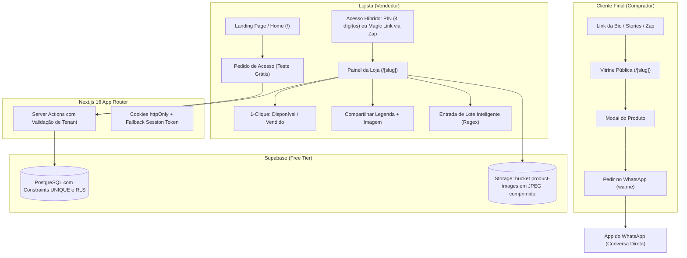
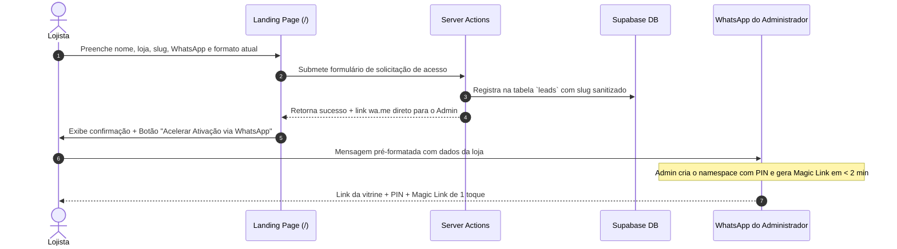

# StokFácil — Blueprint de Implementação Técnica e de Produto (Revisão Pós-Auditoria)

> **Status:** Aprovado e Refinado após Auditoria Crítica  
> **Base de Referência:** [`docs/estrategia-monetizacao.md`](file:///C:/Users/suayd/Documents/repos/meu-estoque/docs/estrategia-monetizacao.md) e [`docs/requisitos-stokfacil.md`](file:///C:/Users/suayd/Documents/repos/meu-estoque/docs/requisitos-stokfacil.md)  
> **Auditoria:** Subagente Especialista em Arquitetura & Produto  
> **Stack Tecnológica:** Next.js 16 (App Router / Server Actions), React 19, Tailwind CSS v4, Lucide React, Supabase (PostgreSQL + Storage), Zod.

---

## 1. Visão Geral da Arquitetura & Fluxos

O **StokFácil** é uma plataforma ultra-enxuta de vitrine digital e controle de estoque mobile-first voltada para pequenos lojistas (brechós, revendedoras, autônomos e artesãos). A premissa central é eliminar a fricção entre fotos de estoque e fechamento de vendas diretas no WhatsApp e Instagram.

### 1.1 Arquitetura Geral do Sistema (Resiliente a WebViews e Mobile)



### 1.2 Fluxo de Onboarding e Conversão de Leads



---

## 2. Modelo de Dados & Migrações do Banco (Supabase SQL)

> [!IMPORTANT]
> **Ajustes de Segurança e Integridade da Auditoria:**
> 1. Adição de `UNIQUE` estrito no `slug` de `namespaces` e `leads`.
> 2. Políticas de escrita no Supabase blindadas por validação de backend.
> 3. Tolerância de expiração com janela de carência controlada.

### 2.1 Script SQL de Migração e Criação

```sql
-- ============================================================
-- 1. TABELA DE LEADS (Captura de novos lojistas na Home)
-- ============================================================
CREATE TABLE IF NOT EXISTS public.leads (
    id UUID PRIMARY KEY DEFAULT gen_random_uuid(),
    contact_name TEXT NOT NULL,
    store_name TEXT NOT NULL,
    requested_slug TEXT NOT NULL,
    whatsapp TEXT NOT NULL,
    current_inventory_method TEXT,
    status TEXT NOT NULL DEFAULT 'trial_pending', -- 'trial_pending', 'active', 'rejected', 'converted'
    created_at TIMESTAMPTZ NOT NULL DEFAULT timezone('utc'::text, now()),
    notes TEXT,
    CONSTRAINT uq_leads_requested_slug UNIQUE (requested_slug)
);

CREATE INDEX IF NOT EXISTS idx_leads_requested_slug ON public.leads(requested_slug);
CREATE INDEX IF NOT EXISTS idx_leads_whatsapp ON public.leads(whatsapp);

-- ============================================================
-- 2. AJUSTES NA TABELA NAMESPACES (Lojas)
-- ============================================================
ALTER TABLE public.namespaces 
    ADD COLUMN IF NOT EXISTS whatsapp TEXT,
    ADD COLUMN IF NOT EXISTS status TEXT NOT NULL DEFAULT 'active', -- 'active', 'trial_grace_period', 'paused', 'blocked'
    ADD COLUMN IF NOT EXISTS plan TEXT NOT NULL DEFAULT 'trial',     -- 'trial', 'monthly', 'quarterly', 'semiannual', 'annual'
    ADD COLUMN IF NOT EXISTS trial_starts_at TIMESTAMPTZ DEFAULT timezone('utc'::text, now()),
    ADD COLUMN IF NOT EXISTS trial_expires_at TIMESTAMPTZ DEFAULT (timezone('utc'::text, now()) + interval '14 days'),
    ADD COLUMN IF NOT EXISTS trial_extended BOOLEAN NOT NULL DEFAULT false,
    ADD COLUMN IF NOT EXISTS activation_completed BOOLEAN NOT NULL DEFAULT false,
    ADD COLUMN IF NOT EXISTS is_whitelabel BOOLEAN NOT NULL DEFAULT false,
    ADD COLUMN IF NOT EXISTS instagram_handle TEXT,
    ADD COLUMN IF NOT EXISTS logo_url TEXT;

-- Garantir restrição de unicidade no slug da loja
DO $$
BEGIN
    IF NOT EXISTS (
        SELECT 1 FROM pg_constraint WHERE conname = 'uq_namespaces_slug'
    ) THEN
        ALTER TABLE public.namespaces ADD CONSTRAINT uq_namespaces_slug UNIQUE (slug);
    END IF;
END $$;

CREATE INDEX IF NOT EXISTS idx_namespaces_slug ON public.namespaces(slug);
CREATE INDEX IF NOT EXISTS idx_namespaces_trial_expires ON public.namespaces(trial_expires_at);

-- ============================================================
-- 3. AJUSTES NA TABELA ITEMS
-- ============================================================
CREATE INDEX IF NOT EXISTS idx_items_namespace_created ON public.items(namespace_id, created_at DESC);
CREATE INDEX IF NOT EXISTS idx_items_is_sold ON public.items(namespace_id, is_sold);

-- ============================================================
-- 4. POLÍTICAS DE SEGURANÇA (RLS)
-- ============================================================
ALTER TABLE public.namespaces ENABLE ROW LEVEL SECURITY;
ALTER TABLE public.items ENABLE ROW LEVEL SECURITY;
ALTER TABLE public.leads ENABLE ROW LEVEL SECURITY;

-- Leitura pública para vitrines ativas ou em período de tolerância
CREATE POLICY "Leitura pública de namespaces ativos"
    ON public.namespaces FOR SELECT
    USING (status IN ('active', 'trial_grace_period'));

CREATE POLICY "Leitura pública de itens da loja ativa"
    ON public.items FOR SELECT
    USING (
        EXISTS (
            SELECT 1 FROM public.namespaces ns 
            WHERE ns.id = items.namespace_id 
            AND ns.status IN ('active', 'trial_grace_period')
        )
    );

-- Inserção pública para novos leads na Home Page
CREATE POLICY "Inserção pública de novos leads"
    ON public.leads FOR INSERT
    WITH CHECK (true);
```

---

## 3. Resolução dos Gargalos Técnicos e Mobile (Auditoria)

### 3.1 Tratamento de WebViews e Autenticação Resiliente
> [!NOTE]
> WebViews de Instagram e WhatsApp no iOS descartam cookies de sessão com frequência agressiva ao fechar ou reabrir o app.

- **Solução Implementada no Blueprint:**
  1. **Autenticação Padrão:** Cookie `httpOnly`, `SameSite=Lax`, `Secure`.
  2. **Magic Link de Acesso Rápido:** Ao criar a loja ou ao solicitar no WhatsApp, o lojista recebe um link de gestão com token temporário assinado:
     `https://stokfacil.com/sua-loja?auth_token=JWT_OU_HASH`
  3. Ao abrir esse link em qualquer navegador ou WebView, o backend valida o token, emite/renova a sessão e abre o painel já autenticado sem exigir digitação de PIN no teclado virtual.

### 3.2 Otimização de Imagens no Celular, Câmeras de 48MP e Suporte a HEIC
> [!WARNING]
> Fotos de iPhone em `.heic` e fotos de câmeras modernas (8000x6000 px) causam Out of Memory (OOM) no Safari móvel se desenhadas diretamente em `<canvas>` sem redimensionamento progressivo.

- **Pipeline de Upload Mobile (`src/lib/imageCompression.ts`):**
  1. **Detecção de Formato:** Se o arquivo for `.heic` ou `.heif`, converter utilizando biblioteca leve client-side (`heic2any` com import dinâmico sob demanda).
  2. **Step-Down Resizing:** Reduzir fotos em etapas graduais até dimensão máxima de **1280px** (largura/altura).
  3. **Compressão para JPEG 0.75:** Gera arquivo entre 150KB e 350KB com altíssima nitidez em telas de celular e 100% de compatibilidade em WebViews antigas.
  4. **Preservação de Orientação EXIF:** Corrige rotações automáticas antes do upload para o Supabase Storage.

### 3.3 Fast Batch Insert Inteligente (Tolerante a Moeda Brasileira e Textos Livres)
> [!TIP]
> Lojistas de brechós e autônomos não utilizam CSV com precisão técnica. O formato comum no WhatsApp é texto informal com `R$ 89,90` ou vírgulas misturadas.

- **Parser com Expressões Regulares (`src/lib/batchParser.ts`):**
  - **Identificação de Preço:** Extrai automaticamente qualquer padrão monetário:
    - `R$ 89,90` / `89,90` / `120.00` / `45 reais` / `R$50`
  - **Identificação do Título e Descrição:** O restante da linha é limpo de traços, numerações iniciais (`1.`, `-`) e pontuações excedentes.
  - **Tabela de Pré-Visualização Editável:** Antes de inserir no banco, o sistema abre uma mini-grade visual permitindo que o lojista altere rapidamente qualquer preço ou título com máscaras monetárias intuitivas.

### 3.4 Fallback Robusto para Web Share API
- O botão de imagem tenta `navigator.canShare({ files: [file] })`.
- Se o navegador estiver em WebView do Instagram ou rejeitar a chamada com `NotAllowedError`, o sistema ativa imediatamente o fallback com download via `blob:` e exibe instrução de 1 toque: *"Foto salva na sua galeria!"*.

---

## 4. Plano de Implementação em Fases (WBS)

```mermaid
flowchart LR
    subgraph Fase1["Fase 1: Conversão & WhatsApp (MVP de Vendas)"]
        F1_1["Rebranding StokFácil"]
        F1_2["LP de Captura de Leads"]
        F1_3["Botão 'Pedir no Zap'"]
        F1_4["Configuração WhatsApp"]
        F1_5["Compartilhamento Insta/Bio"]
        F1_6["Magic Link / WebViews"]
    end

    subgraph Fase2["Fase 2: Anti-Fricção & Trial"]
        F2_1["Parser Inteligente de Lote"]
        F2_2["Setup Concierge Ajustado (15 itens)"]
        F2_3["Trial Control & Banner 5 Dias"]
        F2_4["Compressão HEIC/JPEG Mobile"]
    end

    subgraph Fase3["Fase 3: Escala & Monetização"]
        F3_1["Rodapé White-Label (Anual)"]
        F3_2["Upload em Esteira Contínua"]
        F3_3["Tolerância Pós-Trial de 7 Dias"]
        F3_4["Gerador Kit Balcão PDF"]
    end

    Fase1 --> Fase2 --> Fase3
```



---

### Fase 1 — Rebranding, Captura de Leads e Super-Poder WhatsApp (Alta Prioridade)

#### 1.1 Rebranding & Identidade Visual StokFácil (`RF01`)
- **Arquivos:** `src/app/layout.tsx`, `src/app/page.tsx`, `src/components/ItemList.tsx`.
- Metatags OpenGraph completas para pré-visualização no WhatsApp e Stories.
- Ícone e identidade com foco em simplicidade extrema.

#### 1.2 Landing Page de Captura e Tabela de Planos (`RF03`, `RF04`, `RF05`)
- **Arquivos:** `src/app/page.tsx`, `src/components/LeadCaptureForm.tsx`, `src/components/PricingSection.tsx`.
- Form de cadastro simplificado com slug sanitizado em tempo real.
- Grade de preços transparente:
  - Mensal: R$ 39/mês
  - Trimestral: R$ 99/trimestre
  - Semestral: R$ 169/semestre
  - **Anual: R$ 299/ano** (equivalente a R$ 24,90/mês, com Setup VIP de até 15 itens incluso, White-label e PDF de balcão).

#### 1.3 Configuração de WhatsApp da Loja e Autenticação por Magic Link (`RF10`)
- **Arquivos:** `src/app/actions.ts`, `src/components/ItemList.tsx`.
- Cadastro de número WhatsApp no namespace.
- Geração de link com token para evitar deslogamentos acidentais em WebViews.

#### 1.4 Pedido Direto com 1 Clique no WhatsApp (`RF09`)
- Botão no modal do produto gerando link `https://wa.me/55...` com texto codificado:
  > *"Olá! Vi o produto [Título] (R$ [Preço]) na sua vitrine StokFácil. Ainda está disponível?"*

#### 1.5 Super-Poder de Compartilhamento (Instagram & Bio) (`RF11`)
- Botão de cópia de legenda formatada com emojis e link para colar no feed/stories.
- Botão "Copiar Link da Bio" com feedback visual de confirmação.

---

### Fase 2 — Anti-Fricção, Gestão de Trial e Performance (Média Prioridade)

#### 2.1 Fast Batch Insert com Parser Inteligente (`RF06`)
- **Arquivos:** `src/components/BatchImportModal.tsx`, `src/lib/batchParser.ts`, `src/app/actions.ts`.
- Aceita colagem de texto sem separador rígido, interpretando moedas no padrão brasileiro.

#### 2.2 Canal Concierge Sustentável (`RF08`)
- Botão de suporte para cadastro com limite de **até 15 peças iniciais** (evitando gargalo operacional para o solopreneur).

#### 2.3 Controle de Trial Dinâmico "14+16" e Banner de Renovação Pix (`RF13`, `RF14`)
- **Decisão Arbitrada (Modelo de Ativação Progressiva 14+16 Dias):**
  - **Base Inicial:** Todo novo cadastro inicia automaticamente com **14 dias de teste**.
  - **Gatilho de Bônus (+16 dias = 30 dias totais):** Assim que o lojista cadastrar pelo menos 5 produtos e compartilhar o link da vitrine (`activation_completed = true`), o sistema atualiza `trial_expires_at = trial_starts_at + interval '30 days'` e `trial_extended = true`.
  - **Régua de Acompanhamento no WhatsApp:**
    - **D+2 (Se 0 itens cadastrados):** *"Oi [Nome], vi que você ainda não subiu suas peças. Quer ajuda para cadastrar as primeiras 5 para garantir seus 30 dias de presente?"*
    - **D+4 a D+7 (Ao atingir a meta):** *"Parabéns! Sua vitrine está no ar. Como prometido, liberamos seu acesso para 30 dias completos!"*
  - **Banner de Contagem Regressiva:** Exibido no topo do painel quando faltarem 5 dias para o término do trial ativo (dia 9 no trial base, ou dia 25 no trial estendido).
  - **Botão Pix Direto:** Acelera renovação sem gateway com mensagem pré-formatada para o WhatsApp do fundador.

#### 2.4 Compressão Mobile com Suporte a HEIC (`RNF02`)
- **Arquivo:** `src/lib/imageCompression.ts`.
- Normalização de fotos de iPhone, limite de 1280px e saída JPEG 0.75 para economia de banda e Supabase Storage.

---

### Fase 3 — Escala, White-Label e Gestão do Ciclo de Vida (Baixa Prioridade)

#### 3.1 Rodapé White-Label Condicional (`RF02`)
- Permite ocultar *"Criado com StokFácil"* apenas para lojistas com plano Anual ativo.

#### 3.2 Tolerância de 7 Dias Pós-Trial e Pausa de Vitrine (`RF15`)
- **Regra de Negócio Pós-Auditoria e Arbitragem:**
  - **Período Ativo (14 ou 30 dias):** Edição e visualização pública 100% liberadas.
  - **Carência Tolerante (+7 dias após expirar):** Edição bloqueada; vitrine pública permanece online para não perder vendas em curso.
  - **A partir de D+8 pós-expiração:** Vitrine entra em status `paused`, exibindo mensagem cortês: *"A vitrine da [Loja] está temporariamente pausada para renovação. Chame a loja no WhatsApp aqui."*

---

## 5. Estratégia de Testes e Controle de Qualidade

Seguindo o protocolo da skill `test-meu-estoque`:

1. **Build & Compilação Next.js 16:**
   `npm run build`
2. **Linting Estrito:**
   `npm run lint`
3. **Smoke Tests:**
   Validação de resposta HTTP 200 nas rotas `/` e `/[slug]`.
4. **Bateria de Testes Mobile:**
   - Teste de upload de fotos em formato `.heic` e fotos tiradas com câmera de 48MP no Safari móvel.
   - Teste de abertura de link e clique no botão de WhatsApp dentro do navegador in-app do Instagram.
   - Teste do parser em lote com colagem de lista contendo `R$ 89,90`, `R$ 120` e descrições sem vírgula.
